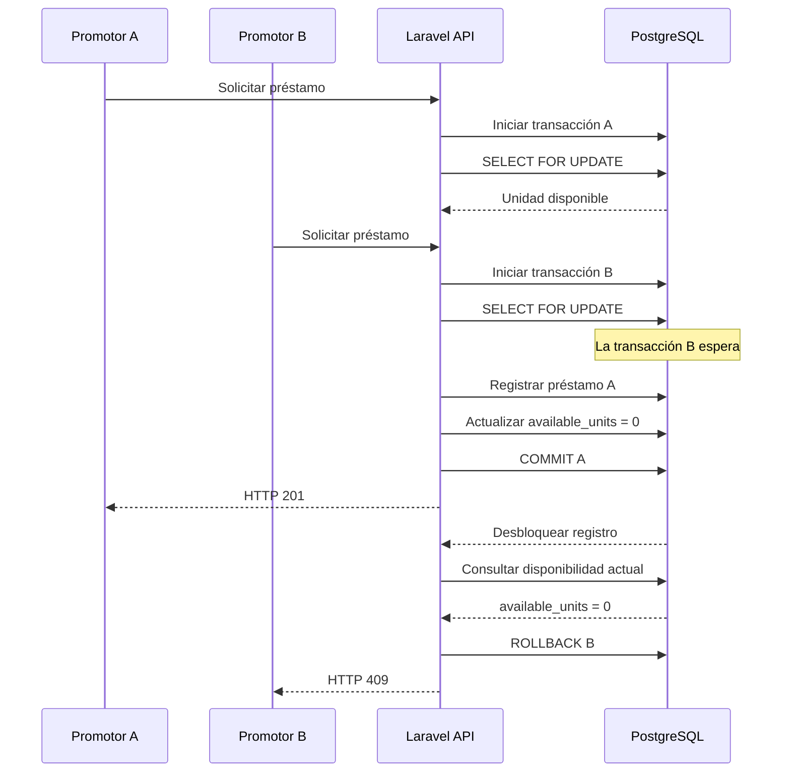

# ADR-002 — Control de Concurrencia en Préstamos de Juguetes

**Proyecto:** Toy Library — Juegoteca Comunitaria de Juguetes  
**Identificador:** `toy-library`  
**Código del aprendiz:** A13  
**Ficha:** ADSO 3239137  
**Fecha:** 11 de noviembre de 2026  
**Estado:** Aceptado  
**Categoría:** Concurrencia e integridad de datos

## 1. Contexto

Toy Library es una aplicación web que permite administrar el inventario y los préstamos de juguetes de una juegoteca comunitaria.

Los administradores y promotores pueden registrar préstamos a diferentes familias utilizando el mismo inventario.

Cada juguete tiene una cantidad total de unidades (`total_units`) y una cantidad disponible (`available_units`).

El sistema debe garantizar que las unidades disponibles nunca sean negativas ni superen la cantidad total.

Uno de los requisitos principales del Acta No. 13 establece que, cuando dos operadores intenten entregar simultáneamente la última unidad de un juguete, solamente una operación podrá completarse y la otra deberá recibir HTTP 409.

Para cumplir esta condición es necesario controlar las operaciones simultáneas sobre los registros del inventario.

## 2. Problema identificado

Puede producirse una condición de carrera cuando dos promotores consultan y modifican simultáneamente las unidades disponibles de un mismo juguete.

Por ejemplo, un juguete tiene una sola unidad disponible.

Dos promotores intentan registrar un préstamo al mismo tiempo:

1. El promotor A consulta el inventario y encuentra una unidad.
2. El promotor B consulta el mismo inventario y también encuentra una unidad.
3. El promotor A registra el préstamo.
4. El promotor B intenta registrar otro préstamo.
5. Si no existe control de concurrencia, ambas operaciones podrían completarse incorrectamente.

Esto podría generar más préstamos que unidades disponibles.

El sistema también debe evitar que dos operaciones concurrentes permitan a una familia superar el límite máximo de tres juguetes pendientes.

## 3. Decisión arquitectónica

Se decide utilizar **transacciones de PostgreSQL y bloqueo pesimista de filas mediante `SELECT FOR UPDATE`**.

En Laravel, el bloqueo podrá implementarse mediante `lockForUpdate()` dentro de una transacción.

Las operaciones que modifican inventario deberán ejecutarse de forma atómica.

El objetivo es garantizar que las validaciones y las modificaciones se realicen sobre información consistente.

### 3.1. Principios de la solución

- Cada préstamo se ejecutará dentro de una transacción.
- Se bloqueará el registro de la familia para controlar sus préstamos pendientes.
- Se bloquearán los juguetes solicitados antes de modificar el inventario.
- Los juguetes se bloquearán en un orden consistente.
- Se comprobará nuevamente la disponibilidad después de adquirir los bloqueos.
- El inventario se modificará únicamente si todas las reglas se cumplen.
- Si una validación falla, la transacción se revertirá.
- No se permitirán préstamos parciales.

## 4. Estrategia de bloqueo

### 4.1. Bloqueo de familia

Antes de registrar un préstamo se bloqueará la fila correspondiente a la familia.

Esto permitirá serializar las operaciones de préstamo de una misma familia.

Después de adquirir el bloqueo, el sistema comprobará:

- La existencia de juguetes vencidos pendientes.
- La cantidad total de juguetes sin devolver.
- La cantidad de nuevos juguetes solicitados.
- El límite máximo de tres juguetes pendientes.

El bloqueo impedirá que dos solicitudes simultáneas superen el límite cuando ambas utilicen el mismo procedimiento transaccional.

### 4.2. Bloqueo de juguetes

Los registros de los juguetes solicitados se bloquearán mediante `SELECT FOR UPDATE`.

Si un préstamo contiene varios juguetes, sus identificadores se ordenarán de manera determinista antes de adquirir los bloqueos.

Esto reduce la posibilidad de interbloqueos entre transacciones.

Después de bloquear cada juguete, se verificará que:

- El juguete exista.
- El juguete esté activo.
- Existan unidades disponibles.
- La operación no produzca inventario negativo.

### 4.3. Orden de adquisición

Todas las operaciones de préstamo deberán seguir el mismo orden:

1. Iniciar la transacción.
2. Bloquear la familia.
3. Validar préstamos pendientes y vencidos.
4. Ordenar los identificadores de los juguetes.
5. Bloquear los juguetes en ese orden.
6. Validar disponibilidad.
7. Registrar el préstamo y sus líneas.
8. Descontar las unidades.
9. Confirmar la transacción.

Las operaciones de devolución y actualización de inventario también deberán utilizar bloqueos y un orden de acceso compatible para reducir riesgos de interbloqueo.

## 5. Flujo de registro de préstamo

El servicio de aplicación coordinará la operación.

### 5.1. Entrada

La solicitud recibirá:

- Identificador de la familia.
- Lista de identificadores de juguetes.
- Identidad del promotor autenticado.

### 5.2. Validaciones

Antes de confirmar el préstamo se comprobará:

1. Que la familia exista.
2. Que el usuario tenga permisos.
3. Que la solicitud contenga entre uno y tres juguetes.
4. Que no existan juguetes repetidos.
5. Que la familia no tenga juguetes vencidos pendientes.
6. Que no se supere el límite de tres juguetes pendientes.
7. Que los juguetes existan y estén activos.
8. Que cada juguete tenga una unidad disponible.

### 5.3. Persistencia

Si todas las validaciones son satisfactorias:

1. Se crea un registro en `loans`.
2. Se crean las líneas correspondientes en `loan_items`.
3. Se conservan los datos históricos de cada juguete.
4. Se descuentan las unidades disponibles.
5. Se confirma la transacción.

Si alguna validación falla, se cancelará la operación completa.

## 6. Ejemplo de implementación en Laravel

El siguiente pseudocódigo muestra cómo se organizará la operación.

```php
DB::transaction(function () use ($familyId, $toyIds, $promoterId) {
    $family = FamilyModel::query()
        ->whereKey($familyId)
        ->lockForUpdate()
        ->firstOrFail();

    $this->validateFamilyEligibility($family, count($toyIds));

    $sortedToyIds = collect($toyIds)->sort()->values();

    $toys = [];

    foreach ($sortedToyIds as $toyId) {
        $toy = ToyModel::query()
            ->whereKey($toyId)
            ->lockForUpdate()
            ->firstOrFail();

        if ($toy->deleted_at !== null || $toy->available_units < 1) {
            throw new ToyNotAvailableException();
        }

        $toys[] = $toy;
    }

    $loan = $this->createLoan($family, $promoterId);

    foreach ($toys as $toy) {
        $this->createLoanItemWithSnapshot($loan, $toy);
        $toy->available_units -= 1;
        $toy->save();
    }

    return $loan;
});
```

Este fragmento es un ejemplo de diseño, no una implementación completa lista para ejecutar.

Los métodos de validación, creación de préstamos y manejo de excepciones deberán implementarse en sus respectivas capas.

La validación de la familia se realizará después de adquirir su bloqueo, consultando los préstamos pendientes y vencidos.

## 7. Escenario de concurrencia obligatorio

### 7.1. Estado inicial

Un juguete tiene:

```text
total_units = 1
available_units = 1
```

Dos promotores autenticados intentan prestar ese mismo juguete a dos familias diferentes.

### 7.2. Secuencia

| Momento | Promotor A | Promotor B |
|---|---|---|
| 1 | Inicia transacción | Inicia transacción |
| 2 | Bloquea el juguete | Intenta bloquear el mismo juguete |
| 3 | Verifica una unidad disponible | Espera el bloqueo |
| 4 | Registra el préstamo | Continúa esperando |
| 5 | Descuenta la unidad y confirma | Obtiene el bloqueo |
| 6 | Recibe HTTP 201 | Detecta cero unidades |
| 7 | Finaliza | Revierte y recibe HTTP 409 |

### 7.3. Resultado esperado

- Se registra un solo préstamo exitoso.
- La segunda solicitud recibe HTTP 409.
- La cantidad disponible termina en cero.
- No se registra un segundo préstamo de la misma unidad.
- No se produce inventario negativo.

## 8. Diagrama de secuencia



## 9. Integridad del inventario

Además de los bloqueos, PostgreSQL deberá aplicar restricciones de integridad.

La tabla `toys` deberá garantizar:

```sql
CHECK (
    available_units >= 0
    AND available_units <= total_units
)
```

También deberá cumplirse:

```sql
CHECK (total_units >= 1)
```

Estas restricciones funcionarán como protección adicional ante errores de implementación.

Las operaciones deberán validar el inventario antes de realizar modificaciones.

## 10. Control del límite por familia

El mismo mecanismo transaccional deberá proteger el límite máximo de tres juguetes pendientes por familia.

### 10.1. Ejemplo

Una familia tiene dos juguetes pendientes.

Dos promotores intentan registrar al mismo tiempo un nuevo préstamo de un juguete cada uno.

Sin control de concurrencia, ambas solicitudes podrían consultar el conteo de dos y permitir que la familia terminara con cuatro juguetes pendientes.

### 10.2. Solución

Se bloqueará el registro de la familia antes de consultar sus préstamos pendientes.

La primera operación podrá completar el préstamo y aumentar el conteo a tres.

La segunda operación, después de obtener el bloqueo, deberá consultar nuevamente el conteo actualizado.

Como el límite ya se alcanzó, la solicitud será rechazada con HTTP 422 y el código `FAMILY_LIMIT_EXCEEDED`.

De esta manera, la familia no podrá superar el límite definido en la especificación.

## 11. Concurrencia durante las devoluciones

Las devoluciones también modificarán el inventario.

Por esta razón deberán ejecutarse mediante transacciones.

### 11.1. Flujo

1. Iniciar la transacción.
2. Bloquear los registros necesarios en un orden consistente.
3. Verificar que la línea de préstamo no haya sido devuelta.
4. Registrar la fecha de devolución.
5. Incrementar una unidad disponible.
6. Comprobar la integridad del inventario.
7. Confirmar la transacción.

### 11.2. Devolución duplicada

Si dos usuarios intentan devolver simultáneamente la misma línea, únicamente una operación deberá completarse.

La segunda deberá detectar que `returned_at` ya contiene una fecha y responder HTTP 409 con el código `ITEM_ALREADY_RETURNED`.

El inventario deberá incrementarse una sola vez.

## 12. Manejo de errores

Los errores producidos por conflictos de disponibilidad deberán utilizar el contrato HTTP definido.

### 12.1. Juguete sin disponibilidad

**HTTP 409**

```json
{
  "code": "TOY_NOT_AVAILABLE",
  "message": "No hay unidades disponibles.",
  "details": []
}
```

### 12.2. Familia con límite superado

**HTTP 422**

```json
{
  "code": "FAMILY_LIMIT_EXCEEDED",
  "message": "La familia no puede superar tres juguetes pendientes de devolución.",
  "details": []
}
```

### 12.3. Devolución duplicada

**HTTP 409**

```json
{
  "code": "ITEM_ALREADY_RETURNED",
  "message": "Este juguete ya fue devuelto.",
  "details": []
}
```

Los errores deberán mantener la estructura definida en `api-contract.md`.

## 13. Alternativas consideradas

### Alternativa 1. Validación sin bloqueo

Consiste en consultar las unidades disponibles antes de registrar un préstamo, sin utilizar transacciones ni bloqueos.

**Ventajas:**

- Implementación sencilla.
- Menor cantidad de operaciones de control.

**Desventajas:**

- Permite condiciones de carrera.
- No garantiza integridad ante solicitudes simultáneas.
- Puede producir préstamos incorrectos.

**Resultado:** descartada.

### Alternativa 2. Bloqueo optimista

Consiste en utilizar versiones de registro o actualizaciones condicionales para detectar modificaciones concurrentes.

**Ventajas:**

- Reduce el tiempo de bloqueo.
- Puede funcionar correctamente con operaciones concurrentes.

**Desventajas:**

- Requiere controlar conflictos y reintentos.
- Puede complicar las operaciones con múltiples juguetes.
- Necesita mecanismos adicionales para el límite por familia.

**Resultado:** no seleccionada para este proyecto.

### Alternativa 3. Bloqueo pesimista mediante PostgreSQL

Consiste en utilizar transacciones y `SELECT FOR UPDATE` para controlar el acceso a los registros involucrados.

**Ventajas:**

- Evita que dos transacciones modifiquen simultáneamente la misma fila bloqueada.
- Facilita verificar la disponibilidad antes del préstamo.
- Permite proteger las operaciones con múltiples registros.
- Se integra con las transacciones de Laravel.

**Desventajas:**

- Puede aumentar el tiempo de espera de solicitudes concurrentes.
- Requiere mantener un orden consistente de bloqueo.
- Necesita controlar posibles interbloqueos y errores transitorios.

**Resultado:** alternativa seleccionada.

## 14. Consecuencias de la decisión

### 14.1. Consecuencias positivas

- Se protege la integridad del inventario.
- Se evita prestar dos veces la última unidad.
- Se controla el límite de juguetes pendientes por familia.
- Se evita registrar préstamos parciales.
- Las devoluciones pueden realizarse de manera consistente.
- Se cumple el comportamiento de concurrencia exigido en el acta.

### 14.2. Consecuencias negativas

- Algunas solicitudes deberán esperar hasta que termine otra transacción.
- Será necesario implementar cuidadosamente los bloqueos.
- Las transacciones deberán mantenerse lo más cortas posible.
- Se deberán manejar errores de bloqueo o interbloqueo.

### 14.3. Compromisos adquiridos

- Utilizar transacciones en operaciones de préstamo y devolución.
- Bloquear las filas necesarias.
- Mantener un orden consistente de adquisición de bloqueos.
- No realizar llamadas externas dentro de las transacciones.
- Verificar nuevamente las reglas después de adquirir los bloqueos.
- Mantener pruebas automatizadas de concurrencia.

## 15. Estrategia de pruebas

Las pruebas deberán demostrar que el sistema conserva la integridad de los datos ante solicitudes simultáneas.

### 15.1. Prueba de última unidad disponible

**Preparación:**

- Crear un juguete con una unidad disponible.
- Crear dos familias elegibles.
- Crear dos promotores autenticados.

**Ejecución:**

Enviar dos solicitudes de préstamo simultáneas para el mismo juguete.

**Resultado esperado:**

- Una respuesta HTTP 201.
- Una respuesta HTTP 409.
- Exactamente una línea de préstamo registrada.
- `available_units = 0`.

### 15.2. Prueba de límite por familia

**Preparación:**

- Crear una familia con dos juguetes pendientes.
- Preparar dos solicitudes simultáneas para prestar una unidad adicional cada una.

**Resultado esperado:**

- Solo una nueva solicitud se completa.
- La familia termina con tres juguetes pendientes.
- La segunda solicitud se rechaza con HTTP 422.
- No existen préstamos parciales.

### 15.3. Prueba de devolución duplicada

**Preparación:**

- Crear un préstamo con una línea pendiente.
- Preparar dos solicitudes simultáneas de devolución.

**Resultado esperado:**

- Una devolución exitosa.
- Una respuesta HTTP 409.
- El inventario aumenta una sola unidad.
- `returned_at` queda registrado una sola vez.

### 15.4. Base de datos de pruebas

Las pruebas de concurrencia deberán ejecutarse utilizando PostgreSQL real.

No se utilizará una base de datos simulada para validar el comportamiento de bloqueo de filas.

## 16. Criterios de verificación

Esta decisión arquitectónica se considerará correctamente implementada cuando:

- [ ] Los préstamos se ejecuten dentro de transacciones.
- [ ] Las familias se bloqueen antes de validar sus préstamos pendientes.
- [ ] Los juguetes se bloqueen antes de modificar el inventario.
- [ ] Los bloqueos utilicen un orden consistente.
- [ ] Se verifique la disponibilidad después del bloqueo.
- [ ] Los préstamos fallidos no guarden datos parciales.
- [ ] El inventario permanezca dentro del rango permitido.
- [ ] Dos solicitudes sobre la última unidad produzcan HTTP 201 y HTTP 409.
- [ ] Dos devoluciones simultáneas no incrementen dos veces el inventario.
- [ ] Las pruebas de concurrencia se ejecuten con PostgreSQL real.

## 17. Relación con otros documentos

Este ADR deberá mantenerse alineado con:

- `constitution.md`: principios de integridad y consistencia.
- `spec.md`: reglas de préstamos, inventario y concurrencia.
- `plan.md`: estrategia de implementación.
- `architecture.md`: flujos transaccionales.
- `data-model.md`: restricciones de inventario.
- `api-contract.md`: respuestas HTTP y errores.
- `tasks.md`: tareas de persistencia y concurrencia.
- `adr-001-migrations.md`: gestión del esquema PostgreSQL.

## 18. Estado y seguimiento

**Estado de la decisión:** Aceptado.

Se adopta el bloqueo pesimista mediante transacciones PostgreSQL como estrategia para controlar las operaciones simultáneas de préstamos y devoluciones.

La decisión deberá implementarse en el backend Laravel y comprobarse mediante pruebas automatizadas de integración y concurrencia.

La aceptación de este ADR no significa que el mecanismo ya esté implementado ni que las pruebas hayan sido ejecutadas.

---

**ADR-002 — Control de Concurrencia — Toy Library A13 — Ficha 3239137.**
