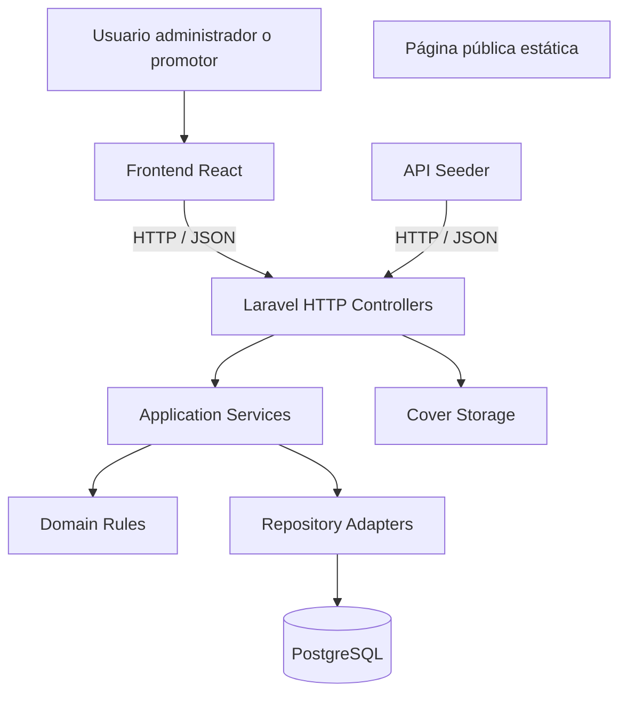
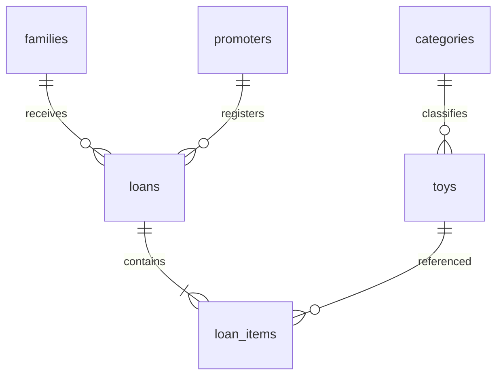
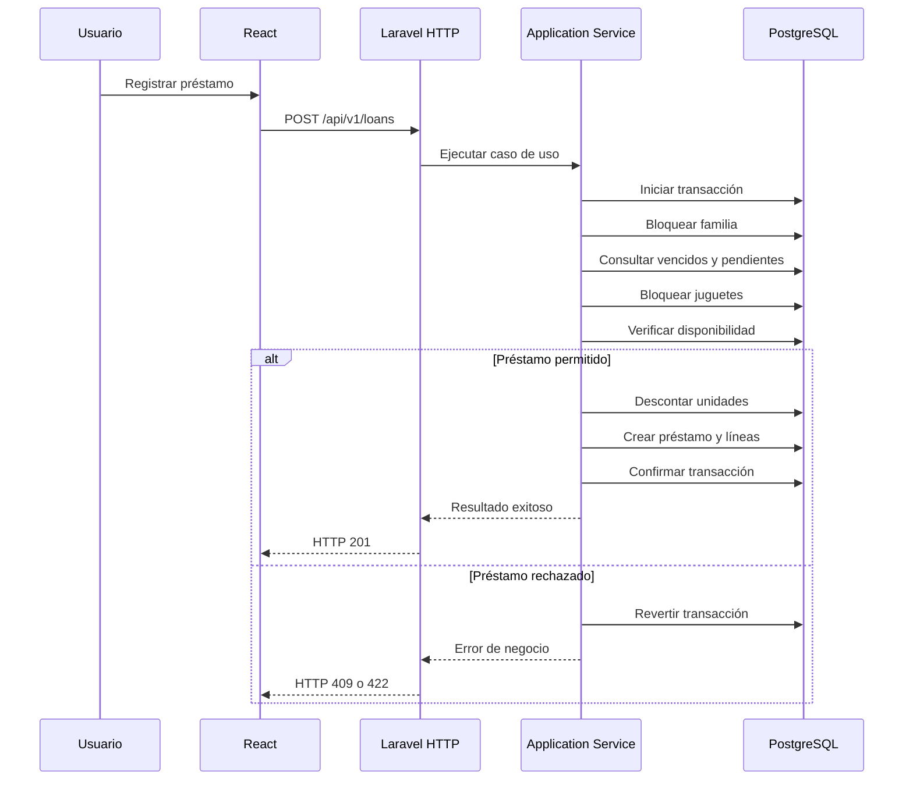

# Arquitectura del Sistema — Toy Library

**Proyecto:** Toy Library — Juegoteca Comunitaria de Juguetes  
**Identificador:** `toy-library`  
**Programa:** Análisis y Desarrollo de Software (ADSO)  
**Ficha:** 3239137  
**Aprendiz:** A13  
**Versión:** 1.0  
**Estado:** Arquitectura propuesta

## 1. Propósito

Este documento describe la arquitectura técnica de Toy Library, una aplicación web destinada a gestionar el inventario y los préstamos de juguetes de una juegoteca comunitaria.

La arquitectura establece cómo se organizan los componentes del sistema, cómo se comunican entre sí y cómo se implementarán las reglas de negocio.

El diseño busca garantizar la integridad de la información, la seguridad de las operaciones, la separación de responsabilidades y la facilidad para ejecutar pruebas automatizadas.

La implementación deberá mantenerse alineada con los documentos `constitution.md`, `spec.md`, `data-model.md` y `api-contract.md`.

## 2. Estilo arquitectónico

Toy Library utilizará una arquitectura cliente-servidor, con un backend monolítico modular organizado en capas.

El sistema estará compuesto por:

- **Frontend:** aplicación React utilizada por administradores y promotores.
- **Backend:** API REST desarrollada con PHP y Laravel.
- **Dominio:** componentes responsables de las reglas de negocio.
- **Persistencia:** repositorios y adaptadores de acceso a PostgreSQL.
- **Base de datos:** almacenamiento de la información del sistema.
- **Página pública:** sitio estático para presentar Toy Library.
- **Herramientas:** sembrador de datos mediante la API.
- **Infraestructura:** contenedores Docker para ejecutar los servicios.

No se utilizará una arquitectura de microservicios, ya que las funcionalidades del proyecto pueden organizarse dentro de una sola aplicación backend.

## 3. Diagrama general de arquitectura



### Descripción del flujo

1. El usuario interactúa con la aplicación React.
2. React envía solicitudes a la API Laravel.
3. Los controladores reciben y validan las solicitudes HTTP.
4. Los servicios de aplicación ejecutan los casos de uso.
5. Las reglas del dominio verifican las condiciones del negocio.
6. Los adaptadores de persistencia realizan las operaciones necesarias en PostgreSQL.
7. Laravel devuelve una respuesta a React.
8. React presenta los resultados y mensajes al usuario en español.

El sembrador de datos también utilizará la API, evitando insertar información directamente en las tablas para crear datos de demostración.

La página pública estática será independiente del sistema de administración.

## 4. Arquitectura del frontend

El frontend se desarrollará utilizando React.

Será responsable de presentar las interfaces, gestionar la navegación y comunicarse con el backend.

### 4.1. Responsabilidades

- Mostrar el formulario de inicio de sesión.
- Presentar las opciones disponibles según el rol.
- Consultar el catálogo de juguetes.
- Mostrar la disponibilidad de unidades.
- Registrar y consultar familias.
- Permitir registrar préstamos y devoluciones.
- Mostrar préstamos activos y vencidos.
- Presentar los reportes administrativos.
- Mostrar mensajes de validación en español.

### 4.2. Organización propuesta

La aplicación React se organizará por responsabilidades:

```text
app/
├── src/
│   ├── components/
│   ├── pages/
│   ├── services/
│   ├── hooks/
│   ├── context/
│   ├── routes/
│   └── utils/
```

**`components/`:** componentes visuales reutilizables.

**`pages/`:** pantallas de las funcionalidades.

**`services/`:** solicitudes HTTP y comunicación con la API.

**`hooks/`:** lógica reutilizable de React.

**`context/`:** estado compartido de autenticación.

**`routes/`:** navegación y protección de rutas.

**`utils/`:** funciones auxiliares de presentación.

Esta organización podrá ajustarse a los archivos reales del frontend, sin modificar el contrato de la API ni agregar funcionalidades fuera de la especificación.

### 4.3. Validaciones

El frontend podrá realizar validaciones básicas para mejorar la experiencia de usuario.

Sin embargo, Laravel será el responsable de validar las reglas de negocio y garantizar la integridad de las operaciones.

## 5. Arquitectura del backend

El backend se desarrollará utilizando PHP y Laravel.

Se organizará mediante cuatro capas principales.

### 5.1. Capa de dominio

Contendrá las reglas fundamentales del negocio.

Sus responsabilidades serán:

- Validar cantidades y disponibilidad.
- Controlar el límite de tres juguetes por familia.
- Calcular el plazo de nueve días.
- Comprobar las restricciones por préstamos vencidos.
- Validar las condiciones de devolución.
- Definir las reglas de conservación del historial.

Las reglas del dominio deberán poder probarse sin depender de controladores HTTP ni de una conexión directa a PostgreSQL.

### 5.2. Capa de aplicación

Contendrá los servicios y casos de uso del sistema.

Sus responsabilidades serán:

- Coordinar el registro de juguetes.
- Gestionar familias y promotores.
- Ejecutar operaciones de préstamos.
- Ejecutar devoluciones.
- Administrar transacciones.
- Obtener consultas y reportes.
- Coordinar las reglas del dominio con los repositorios.

Esta capa no deberá contener lógica de presentación.

### 5.3. Capa de infraestructura

Implementará los mecanismos técnicos utilizados por el sistema.

Sus responsabilidades serán:

- Conexión con PostgreSQL.
- Implementación de repositorios.
- Persistencia de entidades.
- Consultas y bloqueos de registros.
- Manejo de imágenes de juguetes.
- Migraciones de base de datos.
- Integración con servicios técnicos necesarios.

### 5.4. Capa de presentación HTTP

Contendrá los controladores y elementos relacionados con la API REST.

Sus responsabilidades serán:

- Recibir solicitudes HTTP.
- Validar datos de entrada.
- Verificar autenticación y permisos.
- Invocar los servicios de aplicación.
- Transformar resultados a JSON.
- Devolver códigos HTTP apropiados.
- Mantener una estructura uniforme de errores.

## 6. Dependencias entre capas

Las dependencias deben permitir que las reglas de negocio permanezcan independientes de los detalles técnicos.

El dominio no dependerá directamente de Laravel ni de PostgreSQL.

Los controladores utilizarán servicios de aplicación mediante inyección de dependencias.

Los servicios de aplicación utilizarán interfaces o contratos de repositorio cuando sea necesario.

La infraestructura implementará esos contratos utilizando PostgreSQL.

Esta organización facilitará las pruebas y permitirá mantener separadas las responsabilidades.

## 7. Modelo de persistencia

La base de datos seleccionada para Toy Library será PostgreSQL.

Se utilizarán seis tablas principales:

| Tabla | Responsabilidad |
|---|---|
| `categories` | Almacenar las categorías de juguetes |
| `toys` | Registrar juguetes y unidades disponibles |
| `families` | Almacenar las familias beneficiarias |
| `promoters` | Registrar usuarios y roles |
| `loans` | Registrar los préstamos |
| `loan_items` | Registrar los juguetes incluidos en cada préstamo |

### 7.1. Relaciones



### 7.2. Identificadores

Las entidades utilizarán identificadores UUID versión 4.

Los nombres de las tablas y columnas estarán en inglés y utilizarán el formato `snake_case`.

### 7.3. Migraciones

Las tablas, relaciones, índices y restricciones se crearán mediante migraciones Laravel ubicadas en:

`api/database/migrations/`

La base de datos no deberá depender de scripts externos que creen un esquema de negocio diferente al definido en las migraciones.

### 7.4. Integridad del inventario

Para cada juguete deberá cumplirse:

`0 <= available_units <= total_units`

El inventario se modificará únicamente mediante operaciones permitidas por el sistema.

La base de datos deberá incluir las restricciones necesarias para proteger esta condición.

## 8. Arquitectura de autenticación y autorización

El sistema utilizará autenticación mediante tokens JWT.

Los usuarios autenticados serán administradores y promotores.

Las familias serán registros del dominio y no tendrán cuentas para iniciar sesión.

### 8.1. Inicio de sesión

El usuario enviará sus credenciales al endpoint:

`POST /api/v1/auth/login`

Laravel validará las credenciales y, si son correctas, generará el token correspondiente.

Las solicitudes protegidas deberán incluir:

`Authorization: Bearer <token>`

### 8.2. Roles

**Administrador (`admin`)**

Podrá gestionar promotores, juguetes, familias, préstamos, devoluciones y reportes.

**Promotor (`promoter`)**

Podrá consultar juguetes, gestionar familias, registrar préstamos, registrar devoluciones y consultar el historial.

Las operaciones administrativas estarán restringidas según el contrato HTTP.

### 8.3. Protección de información

- Las contraseñas se almacenarán mediante hashes seguros.
- No se devolverán contraseñas ni hashes en las respuestas.
- Los secretos no se publicarán en GitHub.
- Las rutas protegidas validarán el token.
- Los usuarios sin autorización recibirán HTTP 401 o HTTP 403, según corresponda.

## 9. Flujo de registro de préstamos

El registro de préstamos será una operación transaccional.

Debe garantizar que el inventario permanezca correcto, incluso cuando existan solicitudes simultáneas.

### 9.1. Secuencia

1. React envía la solicitud de préstamo.
2. Laravel valida los datos recibidos y la autenticación.
3. El servicio de aplicación inicia una transacción.
4. Se bloquea el registro de la familia.
5. Se comprueba si existen juguetes vencidos.
6. Se calcula la cantidad de juguetes pendientes.
7. Se valida el límite máximo de tres.
8. Se bloquean los registros de los juguetes solicitados, ordenados por UUID.
9. Se comprueba la disponibilidad.
10. Se descuentan las unidades correspondientes.
11. Se crea el préstamo.
12. Se crean sus líneas con información histórica congelada.
13. Se confirma la transacción.
14. La API devuelve HTTP 201.

Si una condición falla, se cancela la transacción sin guardar parcialmente la operación.

### 9.2. Diagrama de secuencia



## 10. Control de concurrencia

Uno de los requisitos principales del proyecto consiste en impedir que dos operadores entreguen simultáneamente la última unidad disponible de un juguete.

### 10.1. Problema

Supongamos que un juguete tiene una sola unidad disponible.

Dos promotores intentan registrar un préstamo al mismo tiempo.

Sin un mecanismo de concurrencia, ambos podrían consultar la misma cantidad disponible y registrar dos entregas.

Esto produciría una inconsistencia en el inventario.

### 10.2. Solución arquitectónica

Se utilizarán transacciones PostgreSQL y bloqueos de filas mediante `SELECT FOR UPDATE`.

Los registros de los juguetes se bloquearán en un orden consistente para reducir el riesgo de interbloqueos.

Las restricciones de base de datos funcionarán como protección adicional.

### 10.3. Resultado esperado

Cuando dos solicitudes intenten entregar la última unidad:

- Una solicitud completará el préstamo.
- La otra recibirá HTTP 409.
- El inventario terminará con cero unidades disponibles.
- No se registrará un préstamo adicional incorrecto.

Esta decisión se documenta en `adr/adr-002-concurrency.md`.

## 11. Flujo de devolución

El registro de una devolución deberá modificar el inventario y la línea de préstamo de forma atómica.

### 11.1. Secuencia

1. El usuario selecciona una línea de préstamo pendiente.
2. React envía la solicitud de devolución.
3. Laravel valida la autenticación y los permisos.
4. El servicio de aplicación inicia una transacción.
5. Se bloquean los registros correspondientes de la línea y del juguete.
6. Se verifica que `returned_at` sea nulo.
7. Se registra la fecha de devolución en UTC.
8. Se incrementa una unidad disponible.
9. Se comprueba la integridad del inventario.
10. Se confirma la transacción.

Si la línea ya fue devuelta, el sistema responderá HTTP 409.

### 11.2. Resultado

Una devolución exitosa deberá:

- Registrar la fecha real de devolución.
- Recuperar una unidad disponible.
- Conservar los datos históricos.
- Evitar devoluciones duplicadas.
- Mantener las restricciones del inventario.

Los préstamos no se eliminarán.

## 12. Conservación del historial

Toy Library deberá mantener información histórica confiable.

### 12.1. Datos congelados

Al registrar una línea de préstamo se conservarán los siguientes datos:

- `toy_name`
- `reference`
- `category_name`

Estos datos representarán la información del juguete en el momento de la operación.

### 12.2. Comportamiento esperado

Si posteriormente un administrador cambia el nombre o la categoría de un juguete:

- El catálogo mostrará la información actualizada.
- Las líneas de préstamos anteriores conservarán sus datos originales.
- Los reportes históricos utilizarán la información congelada.

Esta decisión se documenta en `adr/adr-003-snapshots.md`.

## 13. Estados de préstamos

Los estados de los préstamos se calcularán a partir de sus líneas y fechas.

No se almacenará una columna permanente de estado.

Los estados serán:

| Estado | Descripción |
|---|---|
| `open` | Existen juguetes pendientes y ninguno está vencido |
| `overdue` | Existe al menos un juguete pendiente cuya fecha de vencimiento ya pasó |
| `closed` | Todos los juguetes del préstamo fueron devueltos |

Las fechas se almacenarán en UTC.

Los días de retraso también se calcularán al consultar la información.

## 14. Arquitectura de reportes

El sistema incluirá un reporte de juguetes más solicitados.

### 14.1. Fuente de información

El reporte utilizará los registros históricos de `loan_items`, relacionados con sus préstamos.

No será necesario almacenar una tabla adicional de reportes.

### 14.2. Funcionamiento

El administrador podrá consultar los juguetes más solicitados dentro de un intervalo de fechas.

El sistema deberá:

1. Validar el intervalo recibido.
2. Consultar los préstamos registrados en ese período.
3. Agrupar las líneas por identificador y datos históricos correspondientes.
4. Contar las solicitudes de cada juguete.
5. Ordenar los resultados desde la mayor cantidad.
6. Devolver los datos mediante la API.

Los resultados no incluirán información privada de familias ni promotores.

## 15. Arquitectura de la API REST

La comunicación entre React y Laravel se realizará mediante HTTP.

La ruta base será:

`/api/v1`

Las respuestas utilizarán JSON con nombres de campos en inglés.

### 15.1. Grupos de endpoints

- `/auth`
- `/users`
- `/categories`
- `/toys`
- `/families`
- `/loans`
- `/reports`

### 15.2. Códigos HTTP

| Código | Uso |
|---|---|
| 200 | Consulta u operación exitosa |
| 201 | Recurso creado |
| 401 | Autenticación requerida o incorrecta |
| 403 | Usuario sin permisos |
| 404 | Recurso inexistente |
| 409 | Conflicto de estado o disponibilidad |
| 422 | Datos inválidos o regla de validación incumplida |

### 15.3. Manejo de errores

Las respuestas de error deberán mantener una estructura uniforme.

Ejemplo:

```json
{
  "code": "TOY_NOT_AVAILABLE",
  "message": "No hay unidades disponibles.",
  "details": []
}
```

Los mensajes para usuarios estarán en español.

No se expondrán contraseñas, consultas SQL ni trazas internas.

El contrato completo estará documentado en `api-contract.md`.

## 16. Gestión de imágenes

Los juguetes podrán tener una imagen opcional.

Las imágenes estarán restringidas a archivos JPG o PNG con tamaño máximo de 2 MB.

Laravel será responsable de validar el archivo y gestionar su almacenamiento.

La base de datos almacenará una referencia a la imagen mediante el campo `cover_key`.

Las imágenes no se almacenarán directamente como contenido binario dentro de la tabla `toys`.

## 17. Infraestructura y despliegue

El sistema utilizará contenedores Docker para facilitar su ejecución.

### 17.1. Servicios

La infraestructura deberá permitir ejecutar:

- Aplicación React.
- API Laravel.
- PostgreSQL.

Las configuraciones necesarias estarán ubicadas en `infra/`.

### 17.2. Inicio de servicios

Desde el directorio donde se encuentre el archivo Compose se utilizará:

```bash
docker compose up --build
```

La ubicación exacta del archivo Compose y las variables requeridas se documentarán en el README.

### 17.3. Migraciones

Laravel será responsable de aplicar las migraciones de las seis tablas.

Las cinco categorías iniciales deberán registrarse de forma controlada durante la inicialización.

### 17.4. Sembrador de datos

El sembrador de datos de demostración estará ubicado en `tool/`.

Deberá crear información utilizando las operaciones públicas o autenticadas de la API, según corresponda, y no mediante inserciones SQL directas.

## 18. Estrategia de pruebas

La arquitectura deberá permitir comprobar cada componente de manera independiente.

### 18.1. Pruebas unitarias

Comprobarán las reglas del dominio:

- Validación de cantidades.
- Límite de préstamos.
- Cálculo de vencimientos.
- Estados de préstamos.
- Validaciones de devoluciones.

### 18.2. Pruebas de integración

Comprobarán la comunicación entre los servicios de aplicación, repositorios y PostgreSQL.

Incluirán operaciones de creación, consulta, préstamos y devoluciones.

### 18.3. Pruebas de autenticación

Verificarán el acceso mediante JWT y los permisos de los roles.

### 18.4. Pruebas de concurrencia

Se verificará que dos solicitudes simultáneas sobre la última unidad produzcan exactamente una operación exitosa y una respuesta HTTP 409.

Esta prueba deberá realizarse con PostgreSQL real.

### 18.5. Pruebas del contrato HTTP

Comprobarán los códigos de respuesta, formatos JSON, validaciones y mensajes de error definidos en `api-contract.md`.

El proyecto deberá contar con al menos quince archivos de pruebas automatizadas.

## 19. Decisiones arquitectónicas

Las decisiones técnicas principales estarán documentadas en los siguientes ADR:

| Documento | Decisión |
|---|---|
| `adr-001-migrations.md` | Gestión del esquema mediante migraciones |
| `adr-002-concurrency.md` | Control de concurrencia mediante bloqueo de filas |
| `adr-003-snapshots.md` | Conservación de información histórica |
| `adr-004-security.md` | Autenticación y protección de operaciones |

Cada decisión deberá conservar su contexto, justificación, alternativas y consecuencias.

## 20. Restricciones arquitectónicas

La implementación deberá cumplir las siguientes condiciones:

1. No incorporar funcionalidades fuera de `spec.md`.
2. No permitir que el frontend controle las reglas definitivas del negocio.
3. No permitir inventario negativo.
4. No almacenar estados de préstamos que puedan calcularse.
5. No eliminar préstamos ni devoluciones.
6. No modificar información histórica congelada.
7. No permitir préstamos que superen el límite de tres juguetes pendientes.
8. No permitir nuevos préstamos a familias con juguetes vencidos.
9. No registrar operaciones parciales ante errores.
10. No almacenar contraseñas sin protección.
11. No publicar archivos de entorno con secretos.
12. Mantener los nombres técnicos en inglés y los mensajes al usuario en español.

## 21. Criterios de cumplimiento arquitectónico

La arquitectura se considerará correctamente implementada cuando:

- El frontend React se comunique correctamente con Laravel.
- Los servicios de aplicación coordinen las reglas de negocio.
- La persistencia utilice PostgreSQL.
- Las seis tablas respeten el modelo de datos.
- Las operaciones de préstamos y devoluciones sean transaccionales.
- Se controle correctamente la concurrencia.
- Los datos históricos permanezcan inmutables.
- La autenticación y autorización funcionen correctamente.
- Los errores cumplan el contrato HTTP.
- El sistema pueda ejecutarse mediante Docker.
- Las pruebas automatizadas demuestren el cumplimiento de los requisitos.

## 22. Relación con la documentación

Este documento se complementa con:

- `constitution.md`: principios y normas técnicas.
- `spec.md`: requisitos funcionales y no funcionales.
- `plan.md`: estrategia de implementación.
- `data-model.md`: estructura y restricciones de la base de datos.
- `api-contract.md`: endpoints y formatos de comunicación.
- `tasks.md`: tareas y evidencias.
- `adr/`: decisiones arquitectónicas.

Todas las modificaciones arquitectónicas deberán reflejarse en los documentos afectados.

---

**Toy Library — Arquitectura del Sistema — Plan de Mejoramiento A13 — Ficha 3239137.**
