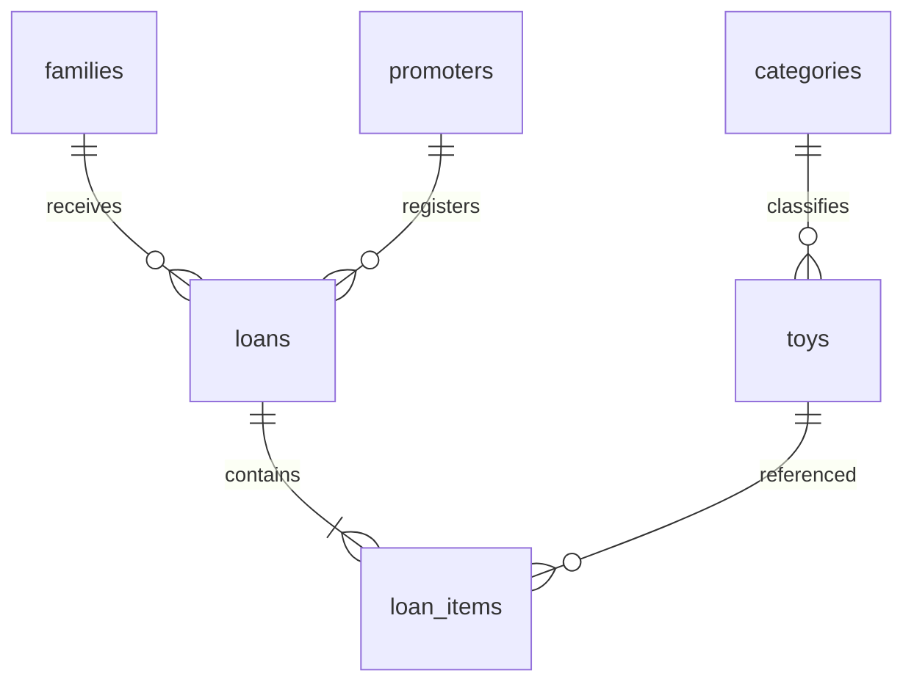

# Modelo de Datos — Toy Library

**Proyecto:** Toy Library — Juegoteca Comunitaria de Juguetes  
**Identificador:** `toy-library`  
**Programa:** Análisis y Desarrollo de Software (ADSO)  
**Ficha:** 3239137  
**Aprendiz:** A13  
**Versión:** 1.0  
**Estado:** Modelo de datos propuesto

## 1. Propósito

Este documento describe la estructura de la base de datos del proyecto Toy Library, un sistema de gestión de préstamos de juguetes para una juegoteca comunitaria.

El modelo establece las entidades, atributos, tipos de datos, relaciones, claves primarias, claves foráneas, restricciones e índices necesarios para administrar juguetes, familias, promotores, préstamos y devoluciones.

Su objetivo es garantizar la integridad de la información, el control del inventario y la conservación del historial de operaciones.

El modelo deberá mantenerse coherente con `constitution.md`, `spec.md`, `architecture.md` y `api-contract.md`.

## 2. Tecnología de persistencia

El sistema utilizará PostgreSQL 16 como motor de base de datos.

La estructura será creada y administrada mediante migraciones de Laravel, ubicadas en:

`api/database/migrations/`

### Convenciones generales

- Se utilizará el esquema `public` de PostgreSQL.
- Las tablas y columnas tendrán nombres en inglés.
- Los identificadores utilizarán UUID versión 4.
- Los nombres de tablas y columnas seguirán el formato `snake_case`.
- Las fechas se almacenarán en UTC mediante `TIMESTAMPTZ`.
- No se almacenarán estados calculados ni días de retraso.
- No se definirán valores `DEFAULT` de negocio en las columnas.
- Las restricciones de integridad deberán aplicarse desde PostgreSQL.

## 3. Entidades del sistema

La base de datos estará compuesta por seis tablas principales.

| Tabla | Descripción |
|---|---|
| `categories` | Categorías de clasificación de juguetes |
| `toys` | Información e inventario de juguetes |
| `families` | Familias beneficiarias |
| `promoters` | Usuarios administradores y promotores |
| `loans` | Registro general de préstamos |
| `loan_items` | Juguetes individuales de cada préstamo |

Estas entidades permiten controlar la disponibilidad de los juguetes, identificar a las familias y conservar las operaciones realizadas.

## 4. Diagrama entidad-relación



### Descripción de las relaciones

1. Una categoría puede contener varios juguetes.
2. Cada juguete pertenece a una categoría.
3. Una familia puede tener varios préstamos.
4. Cada préstamo pertenece a una familia.
5. Un promotor puede registrar varios préstamos.
6. Cada préstamo es registrado por un promotor o administrador.
7. Un préstamo contiene entre una y tres líneas de juguetes.
8. Cada línea representa una unidad prestada de un juguete.
9. Un juguete puede aparecer en distintas líneas de préstamos históricos.

## 5. Tabla `categories`

### 5.1. Descripción

Almacena las categorías utilizadas para clasificar los juguetes.

Las categorías se registrarán inicialmente mediante una migración de base de datos.

### 5.2. Estructura

| Campo | Tipo | Restricción | Descripción |
|---|---|---|---|
| `id` | UUID | PK, NOT NULL | Identificador único |
| `name` | VARCHAR(120) | UNIQUE, NOT NULL | Nombre de la categoría |

### 5.3. Datos iniciales

El sistema deberá contener cinco categorías:

| Código | Categoría |
|---|---|
| 1 | Bebés |
| 2 | Construcción |
| 3 | Didácticos |
| 4 | Exterior |
| 5 | Simbólicos |

Los códigos de esta tabla representan el orden de las categorías, no sus claves primarias. Las claves primarias serán UUID fijos definidos durante la migración.

### 5.4. Reglas

- No se permitirán categorías con nombres duplicados.
- Un juguete deberá estar asociado a una categoría existente.
- No se permitirá eliminar una categoría que esté relacionada con juguetes.
- Las cinco categorías iniciales deberán existir después de ejecutar las migraciones.

## 6. Tabla `toys`

### 6.1. Descripción

Almacena la información de los juguetes disponibles en la juegoteca.

También controla la cantidad total de unidades, las unidades disponibles y la baja lógica del catálogo.

### 6.2. Estructura

| Campo | Tipo | Restricción | Descripción |
|---|---|---|---|
| `id` | UUID | PK, NOT NULL | Identificador del juguete |
| `name` | VARCHAR(250) | NOT NULL | Nombre del juguete |
| `brand` | VARCHAR(200) | NOT NULL | Marca del juguete |
| `reference` | VARCHAR(50) | NOT NULL | Referencia del juguete |
| `category_id` | UUID | FK, NOT NULL | Categoría asociada |
| `total_units` | INTEGER | NOT NULL, CHECK | Total de unidades |
| `available_units` | INTEGER | NOT NULL, CHECK | Unidades disponibles |
| `cover_key` | VARCHAR(512) | NULL | Referencia de la imagen |
| `deleted_at` | TIMESTAMPTZ | NULL | Fecha de baja lógica |

### 6.3. Relaciones

`category_id` referencia `categories(id)`.

Una categoría puede tener muchos juguetes, pero cada juguete pertenece a una sola categoría.

### 6.4. Restricciones

El sistema deberá cumplir:

`total_units >= 1`

`available_units >= 0`

`available_units <= total_units`

La referencia será única entre juguetes activos.

La condición de juguete activo será:

`deleted_at IS NULL`

### 6.5. Inventario

Al registrar un juguete, la cantidad de unidades disponibles será igual a la cantidad total.

Por ejemplo:

- Total de unidades: 5.
- Unidades disponibles inicialmente: 5.
- Después de prestar una unidad: 4.
- Después de devolverla: 5.

Si se modifica la cantidad total de unidades, deberá ajustarse la disponibilidad sin permitir cantidades negativas ni superiores al total.

### 6.6. Baja lógica

Los juguetes no se eliminarán físicamente del catálogo.

Cuando se retire un juguete, se registrará la fecha en `deleted_at`.

Un juguete con préstamos pendientes no podrá darse de baja.

Los préstamos históricos continuarán relacionados con el juguete, aunque este se encuentre inactivo.

## 7. Tabla `families`

### 7.1. Descripción

Almacena la información de las familias beneficiarias de los préstamos.

Cada familia podrá tener varios préstamos a lo largo del tiempo.

### 7.2. Estructura

| Campo | Tipo | Restricción | Descripción |
|---|---|---|---|
| `id` | UUID | PK, NOT NULL | Identificador único |
| `full_name` | VARCHAR(200) | NOT NULL | Nombre de la familia o responsable |
| `document_number` | VARCHAR(30) | UNIQUE, NOT NULL | Documento de identificación |

### 7.3. Reglas

- No podrán existir familias con el mismo número de documento.
- Las familias podrán registrar varios préstamos históricos.
- Una familia no podrá tener más de tres juguetes pendientes de devolución.
- Las familias con juguetes vencidos no podrán recibir nuevos préstamos hasta devolverlos.
- No se permitirá eliminar registros de familias.

### 7.4. Relación

La tabla `loans` contendrá la clave foránea `family_id`, que permitirá identificar a la familia que recibió cada préstamo.

## 8. Tabla `promoters`

### 8.1. Descripción

Almacena los usuarios autorizados para administrar y operar la juegoteca.

El sistema manejará los roles `admin` y `promoter`.

### 8.2. Estructura

| Campo | Tipo | Restricción | Descripción |
|---|---|---|---|
| `id` | UUID | PK, NOT NULL | Identificador del usuario |
| `username` | VARCHAR(120) | UNIQUE, NOT NULL | Nombre de usuario |
| `password_hash` | VARCHAR(512) | NOT NULL | Contraseña protegida mediante hash |
| `role` | VARCHAR(40) | NOT NULL, CHECK | Rol del usuario |

### 8.3. Roles permitidos

Los únicos roles válidos serán:

- `admin`
- `promoter`

La base de datos deberá impedir valores distintos a estos.

### 8.4. Reglas de seguridad

- No se almacenarán contraseñas en texto plano.
- Los nombres de usuario deberán ser únicos.
- El nombre de usuario se normalizará a minúsculas.
- El administrador inicial será configurado desde el entorno.
- No se permitirá registrar nuevos administradores mediante la API.
- Las contraseñas y sus hashes no aparecerán en las respuestas HTTP.

### 8.5. Relación

Cada usuario podrá registrar varios préstamos.

La relación se establecerá mediante `loans.loaned_by_promoter_id`.

Los registros utilizados por préstamos históricos no deberán eliminarse físicamente.

## 9. Tabla `loans`

### 9.1. Descripción

Almacena la información general de los préstamos realizados a las familias.

Cada préstamo estará asociado con una familia y con el usuario que registró la operación.

### 9.2. Estructura

| Campo | Tipo | Restricción | Descripción |
|---|---|---|---|
| `id` | UUID | PK, NOT NULL | Identificador del préstamo |
| `family_id` | UUID | FK, NOT NULL | Familia beneficiaria |
| `loaned_by_promoter_id` | UUID | FK, NOT NULL | Usuario que registra |
| `loaned_at` | TIMESTAMPTZ | NOT NULL | Fecha y hora del préstamo |

### 9.3. Relaciones

`family_id` referencia `families(id)`.

`loaned_by_promoter_id` referencia `promoters(id)`.

Cada préstamo tendrá una o más líneas en `loan_items`.

### 9.4. Reglas

- Cada préstamo pertenecerá a una familia existente.
- Cada préstamo será registrado por un usuario autenticado.
- Los préstamos no podrán eliminarse ni modificarse después de registrarse.
- Las fechas se almacenarán en UTC.
- Cada préstamo contendrá entre una y tres líneas.
- No se permitirá superar el límite de tres juguetes pendientes por familia.
- Las operaciones deberán ejecutarse mediante transacciones.

### 9.5. Estados calculados

El préstamo tendrá uno de los siguientes estados:

| Estado | Descripción |
|---|---|
| `open` | Tiene juguetes pendientes sin vencimiento |
| `overdue` | Tiene al menos un juguete pendiente vencido |
| `closed` | Todos sus juguetes fueron devueltos |

El estado no se almacenará como columna de la tabla.

Se calculará utilizando las fechas de vencimiento y devolución de las líneas.

## 10. Tabla `loan_items`

### 10.1. Descripción

Almacena los juguetes individuales incluidos en cada préstamo.

Cada registro representa una unidad prestada.

Esta tabla permitirá registrar las devoluciones y conservar la información histórica del juguete.

### 10.2. Estructura

| Campo | Tipo | Restricción | Descripción |
|---|---|---|---|
| `id` | UUID | PK, NOT NULL | Identificador de la línea |
| `loan_id` | UUID | FK, NOT NULL | Préstamo asociado |
| `toy_id` | UUID | FK, NOT NULL | Juguete prestado |
| `toy_name` | VARCHAR(250) | NOT NULL | Nombre congelado |
| `reference` | VARCHAR(50) | NOT NULL | Referencia congelada |
| `category_name` | VARCHAR(120) | NOT NULL | Categoría congelada |
| `due_at` | TIMESTAMPTZ | NOT NULL | Fecha límite de devolución |
| `returned_at` | TIMESTAMPTZ | NULL | Fecha efectiva de devolución |

### 10.3. Relaciones

`loan_id` referencia `loans(id)`.

`toy_id` referencia `toys(id)`.

Cada línea pertenece a un préstamo y representa una unidad del juguete seleccionado.

### 10.4. Restricciones

No se permitirá repetir un mismo juguete dentro de un préstamo.

Se utilizará una restricción única compuesta:

`UNIQUE (loan_id, toy_id)`

Una línea pendiente tendrá:

`returned_at IS NULL`

Una línea devuelta tendrá:

`returned_at IS NOT NULL`

### 10.5. Plazo de devolución

Cada línea tendrá una fecha de vencimiento calculada con la siguiente regla:

`due_at = loaned_at + 9 días`

Las fechas deberán almacenarse en UTC.

### 10.6. Conservación de datos históricos

Al registrar una línea de préstamo, se guardará una copia de:

- `toy_name`
- `reference`
- `category_name`

Estos datos serán independientes de los cambios posteriores del catálogo.

Por ejemplo, si un juguete registrado como "Bloques de construcción" cambia de nombre, los préstamos anteriores conservarán el nombre original.

### 10.7. Registro de devoluciones

Cuando se devuelva un juguete:

1. Se verificará que la línea exista.
2. Se comprobará que aún no haya sido devuelta.
3. Se registrará `returned_at` en UTC.
4. Se incrementará una unidad disponible.
5. Se confirmará la transacción.

Si la línea ya fue devuelta, se responderá HTTP 409.

No se permitirá eliminar la línea ni registrar una segunda devolución.

## 11. Claves primarias y foráneas

### 11.1. Claves primarias

Todas las tablas utilizarán una clave primaria UUID llamada `id`.

### 11.2. Claves foráneas

| Tabla origen | Campo | Tabla destino |
|---|---|---|
| `toys` | `category_id` | `categories` |
| `loans` | `family_id` | `families` |
| `loans` | `loaned_by_promoter_id` | `promoters` |
| `loan_items` | `loan_id` | `loans` |
| `loan_items` | `toy_id` | `toys` |

Las relaciones utilizarán restricciones que impidan eliminar registros referenciados.

No se utilizará eliminación en cascada para borrar préstamos ni sus líneas.

## 12. Índices de base de datos

Se utilizarán índices para garantizar unicidad y mejorar las consultas.

| Índice | Tabla | Columnas o condición | Propósito |
|---|---|---|---|
| `categories_name_unique` | `categories` | `name` | Evitar categorías duplicadas |
| `families_document_number_unique` | `families` | `document_number` | Evitar documentos repetidos |
| `promoters_username_unique` | `promoters` | `username` | Evitar usuarios duplicados |
| `ux_active_toy_reference` | `toys` | `reference`, solo activos | Evitar referencias activas duplicadas |
| `ix_active_toy_category_name` | `toys` | `category_id`, `name`, solo activos | Optimizar consultas del catálogo |
| `loans_loaned_at_index` | `loans` | `loaned_at` | Optimizar consultas por fecha |
| `loan_items_toy_id_index` | `loan_items` | `toy_id` | Optimizar consultas por juguete |
| `ix_open_loan_due` | `loan_items` | `due_at`, solo pendientes | Optimizar consultas de vencidos |

Además, existirá una restricción única para la combinación:

`loan_items(loan_id, toy_id)`

Las claves primarias y otras restricciones únicas crearán sus índices correspondientes en PostgreSQL.

## 13. Restricciones de integridad

### 13.1. Cantidad total de juguetes

```sql
CHECK (total_units >= 1)
```

### 13.2. Unidades disponibles

```sql
CHECK (
    available_units >= 0
    AND available_units <= total_units
)
```

### 13.3. Roles permitidos

```sql
CHECK (role IN ('admin', 'promoter'))
```

### 13.4. Referencia única entre juguetes activos

```sql
CREATE UNIQUE INDEX ux_active_toy_reference
ON toys(reference)
WHERE deleted_at IS NULL;
```

### 13.5. Juguete único por préstamo

```sql
UNIQUE (loan_id, toy_id)
```

Estas restricciones deberán implementarse mediante migraciones de Laravel.

Las reglas que dependen de varias tablas o de operaciones simultáneas se comprobarán adicionalmente desde los servicios de aplicación mediante transacciones.

## 14. Manejo de concurrencia

El sistema deberá evitar que dos usuarios presten simultáneamente la última unidad disponible.

### 14.1. Estrategia

Se utilizarán transacciones PostgreSQL con bloqueo de registros.

Durante el préstamo:

1. Iniciar una transacción.
2. Bloquear el registro de la familia.
3. Validar las líneas pendientes y los vencimientos.
4. Bloquear los juguetes solicitados en un orden consistente.
5. Verificar las unidades disponibles.
6. Descontar las unidades.
7. Registrar el préstamo y sus líneas.
8. Confirmar la transacción.

Si una validación falla, la operación se revertirá.

### 14.2. Resultado esperado

Si existe una sola unidad disponible y dos promotores intentan prestarla:

- Una operación se completará con HTTP 201.
- La otra operación recibirá HTTP 409.
- No se registrarán dos préstamos de la misma unidad.
- La disponibilidad final será cero.

Esta decisión se documentará en `adr/adr-002-concurrency.md`.

## 15. Manejo de fechas

Las fechas se almacenarán en UTC mediante PostgreSQL.

Los campos temporales serán:

- `deleted_at`
- `loaned_at`
- `due_at`
- `returned_at`

Las respuestas de la API presentarán fechas en formato ISO 8601, con la zona UTC expresada mediante `Z`.

No se almacenará una columna `days_late`.

Los días de retraso serán calculados mediante la comparación entre `due_at` y la fecha actual.

## 16. Datos iniciales

Las migraciones deberán crear las cinco categorías obligatorias.

| Categoría | Nombre almacenado |
|---|---|
| Bebés | `bebés` |
| Construcción | `construcción` |
| Didácticos | `didácticos` |
| Exterior | `exterior` |
| Simbólicos | `simbólicos` |

Las categorías utilizarán UUID fijos para permitir resultados reproducibles.

El usuario administrador inicial se creará utilizando la configuración del entorno.

Los juguetes, familias y préstamos de demostración se crearán mediante el sembrador ubicado en `tool/`, utilizando los endpoints de la API.

## 17. Consultas de verificación

Las siguientes consultas permitirán comprobar parte de la estructura y el contenido de la base de datos.

### 17.1. Comprobar las seis tablas

```sql
SELECT table_name
FROM information_schema.tables
WHERE table_schema = 'public'
AND table_name IN (
    'categories',
    'toys',
    'families',
    'promoters',
    'loans',
    'loan_items'
)
ORDER BY table_name;
```

Resultado esperado: seis tablas.

### 17.2. Comprobar categorías iniciales

```sql
SELECT name
FROM categories
ORDER BY name;
```

Resultado esperado: cinco categorías.

### 17.3. Comprobar integridad del inventario

```sql
SELECT id, name, total_units, available_units
FROM toys
WHERE available_units < 0
   OR available_units > total_units
   OR total_units < 1;
```

Resultado esperado: cero filas.

### 17.4. Comprobar referencias activas duplicadas

```sql
SELECT reference, COUNT(*)
FROM toys
WHERE deleted_at IS NULL
GROUP BY reference
HAVING COUNT(*) > 1;
```

Resultado esperado: cero filas.

### 17.5. Comprobar préstamos vencidos

```sql
SELECT
    id,
    loan_id,
    toy_id,
    due_at
FROM loan_items
WHERE returned_at IS NULL
AND due_at < NOW()
ORDER BY due_at ASC;
```

Resultado esperado: líneas vencidas, si existen.

### 17.6. Comprobar el límite de préstamos pendientes

```sql
SELECT
    l.family_id,
    COUNT(*) AS pending_toys
FROM loans l
JOIN loan_items li ON li.loan_id = l.id
WHERE li.returned_at IS NULL
GROUP BY l.family_id
HAVING COUNT(*) > 3;
```

Resultado esperado: cero filas.

### 17.7. Comprobar columnas con valores predeterminados

```sql
SELECT
    table_name,
    column_name,
    column_default
FROM information_schema.columns
WHERE table_schema = 'public'
AND table_name IN (
    'categories',
    'toys',
    'families',
    'promoters',
    'loans',
    'loan_items'
)
AND column_default IS NOT NULL;
```

Resultado esperado: cero filas.

## 18. Reglas de persistencia

Durante el desarrollo deberán respetarse las siguientes condiciones:

1. No eliminar físicamente los préstamos.
2. No eliminar las líneas de préstamo.
3. No registrar devoluciones duplicadas.
4. No permitir inventario negativo.
5. No permitir cantidades disponibles superiores al total.
6. No modificar los datos históricos congelados.
7. No prestar más de tres juguetes pendientes por familia.
8. No permitir nuevos préstamos si existen vencidos pendientes.
9. No eliminar físicamente juguetes del catálogo.
10. No modificar el inventario fuera de las operaciones permitidas.
11. No crear tablas fuera de las migraciones Laravel.
12. No almacenar estados de préstamos ni días de retraso calculables.

## 19. Pruebas del modelo de datos

Se deberán implementar pruebas automatizadas para comprobar:

- Creación correcta de las seis tablas.
- Existencia de las cinco categorías.
- Restricciones de claves primarias y foráneas.
- Unicidad de referencias activas.
- Unicidad de documentos.
- Unicidad de nombres de usuario.
- Restricciones de inventario.
- Restricciones de roles.
- Conservación de préstamos históricos.
- Baja lógica de juguetes.
- Integridad de las devoluciones.
- Cumplimiento del límite de tres juguetes.
- Bloqueo por préstamos vencidos.
- Control de concurrencia.

Las pruebas de integración deberán utilizar PostgreSQL para comprobar sus restricciones reales.

## 20. Relación con la documentación

Este documento deberá mantenerse alineado con:

- `constitution.md`: principios y reglas del proyecto.
- `spec.md`: requisitos funcionales y de negocio.
- `plan.md`: estrategia de implementación.
- `architecture.md`: arquitectura y componentes.
- `api-contract.md`: datos de entrada y salida de la API.
- `tasks.md`: tareas y evidencias.
- `adr/`: decisiones de arquitectura.

Cualquier modificación al modelo deberá reflejarse en las migraciones y los documentos correspondientes.

## 21. Criterios de cumplimiento

El modelo de datos se considerará correctamente implementado cuando:

- Existan las seis tablas definidas.
- Las cinco categorías iniciales estén registradas.
- Se apliquen las claves primarias y foráneas.
- Existan los índices de unicidad.
- Se respete la integridad del inventario.
- Los préstamos y devoluciones conserven su historial.
- Los datos congelados permanezcan inmutables.
- Las operaciones simultáneas no produzcan inconsistencias.
- Las migraciones puedan ejecutarse correctamente en PostgreSQL.
- Las consultas y pruebas de verificación demuestren los resultados esperados.

---

**Toy Library — Modelo de Datos — Plan de Mejoramiento A13 — Ficha 3239137.**
